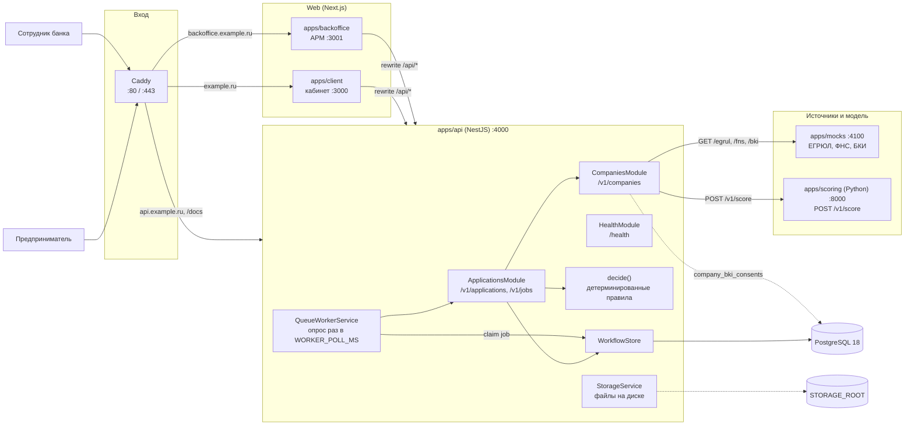

# Архитектура компонентов

Схема построена по `infra/prod/docker-compose.yml`, `Caddyfile`, `apps/*/next.config.js` и модулям `apps/api/src`. Порты и имена сервисов взяты из конфигурации.

SVG: [01-architecture.svg](01-architecture.svg)

## Зависимости

| Откуда                             | Куда          | Как                                                        |
| ---------------------------------- | ------------- | ---------------------------------------------------------- |
| client, backoffice                 | api           | HTTP, `/api/*` проксируется Next.js на `API_URL`           |
| api                                | mocks         | HTTP, таймаут 5 с, три источника запрашиваются параллельно |
| api                                | scoring       | HTTP, `POST /v1/score`                                     |
| api                                | PostgreSQL    | TypeORM, очередь через `FOR UPDATE SKIP LOCKED`            |
| client, backoffice, mocks, scoring | друг с другом | напрямую не общаются                                       |

Типы запросов и ответов лежат в `packages/contracts`, клиент API сгенерирован в `packages/sdk`.

## Что не нарисовано, потому что в коде этого нет

- Отдельного процесса worker нет: `QueueWorkerService` работает внутри процесса api.
- Object storage в compose нет: `StorageService` пишет в локальную папку, MinIO или S3 только заявлены в комментарии.
- Событийного слоя (SSE, шины) нет: изменения состояния попадают в таблицу `application_events`.
- Alfi в `apps/*` нет.
