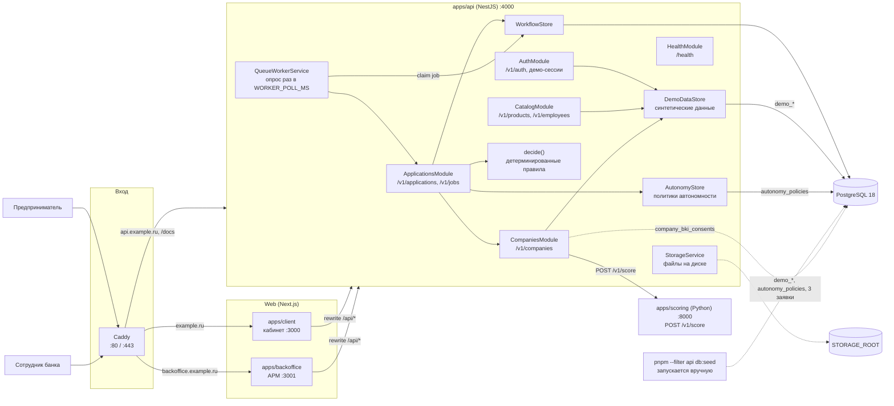

# Архитектура компонентов

Схема построена по `infra/prod/docker-compose.yml`, `Caddyfile`, `apps/*/next.config.js` и модулям `apps/api/src`. Порты и имена сервисов взяты из конфигурации.

SVG: [01-architecture.svg](01-architecture.svg)

## Зависимости

| Откуда                      | Куда                | Как                                                              |
| --------------------------- | ------------------- | ---------------------------------------------------------------- |
| client, backoffice          | api                 | HTTP, `/api/*` проксируется Next.js на `API_URL`                 |
| api                         | scoring             | HTTP, `POST /v1/score`, таймаут 5 с                              |
| api                         | PostgreSQL          | TypeORM, очередь через `FOR UPDATE SKIP LOCKED`                  |
| api                         | `autonomy_policies` | снимок политики и метрик для `GET /v1/applications/{id}/context` |
| client, backoffice, scoring | друг с другом       | напрямую не общаются                                             |

Типы запросов и ответов лежат в `packages/contracts`, клиент API сгенерирован в `packages/sdk`.

## Что не нарисовано, потому что в коде этого нет

- Seed не входит ни в compose, ни в `apps/api/Dockerfile`. После `docker compose up` таблицы `demo_*` пусты: нет демо-учёток, нет `demo_sources`, и каждая задача скоринга после трёх попыток падает с «Синтетические источники не найдены». Пока seed не выполнен вручную, контур в Docker не работает.
- ЕГРЮЛ, ФНС и БКИ не отдельный сервис: `apps/mocks` удалён, `CompaniesService` читает ответы источников из таблицы `demo_sources`, которую заполняет `pnpm db:seed`.
- Отдельного процесса worker нет: `QueueWorkerService` работает внутри процесса api.
- Object storage в compose нет: `StorageService` пишет в локальную папку.
- Событийного слоя (SSE, шины) нет: изменения состояния попадают в таблицу `application_events`.
- Alfi в `apps/*` нет.
