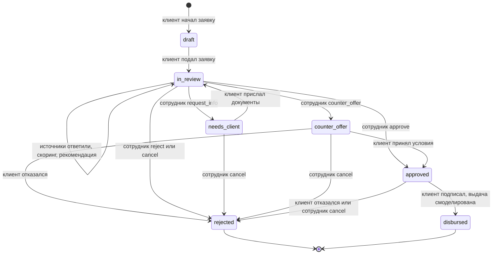
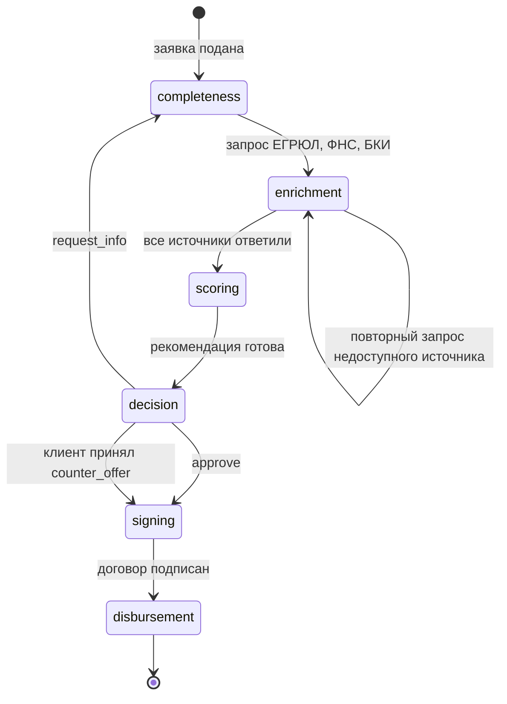

# Статусы заявки

В коде три словаря, а не один. Диаграммы ниже показывают каждый и то, как они связаны.

| Словарь              | Где                                                               | Значения                                                                                   |
| -------------------- | ----------------------------------------------------------------- | ------------------------------------------------------------------------------------------ |
| Публичные статусы    | `applicationStatusSchema`, `packages/contracts/src/index.ts`      | `draft`, `in_review`, `needs_client`, `counter_offer`, `approved`, `disbursed`, `rejected` |
| Статусы воркфлоу api | `applicationWorkflowSchema`, `packages/contracts/src/workflow.ts` | `draft`, `in_review`, `needs_client`, `approved`, `rejected`                               |
| Внутренние этапы     | `applicationStageSchema`, `packages/contracts/src/application.ts` | `intake`, `completeness`, `enrichment`, `scoring`, `decision`, `signing`, `disbursement`   |

## Публичные статусы и переходы

Переходы собраны из `apps/backoffice/src/shared/api/arm/mock/flow.ts` и `apps/client/src/shared/api/cabinet/mock.ts`. Это единственное место, где переходы реализованы. В `apps/api` статус выставляется один раз, `in_review` при создании, а проверки допустимости перехода нет.

Пауза (`pause`), блокировка (`block`) и срочность (`set_urgent`) не меняют статус. Это поле `hold` и флаг в заявке, поэтому на диаграмме их нет. Отмена сотрудником (`cancel`) записывается как `rejected` с причиной `other`.

SVG: [02-statuses-public.svg](02-statuses-public.svg)

## Внутренние этапы

Этап показывает сотруднику, где заявка в конвейере. Клиент его не видит. Поле `waitingOn` (`employee`, `client`, `system`, `nobody`) говорит, чей сейчас ход.

SVG: [02-statuses-stages.svg](02-statuses-stages.svg)

Этап `intake` задан в схеме и в тестовых данных, но мок-движок АРМ его не выставляет: заявка начинается сразу с `completeness`.

## Соответствие этапов и статусов

| Этап                                              | Публичный статус | Чей ход (`waitingOn`)                          |
| ------------------------------------------------- | ---------------- | ---------------------------------------------- |
| `intake`, `completeness`, `enrichment`, `scoring` | `in_review`      | `system`, при недоступном источнике `employee` |
| `decision`                                        | `in_review`      | `employee`                                     |
| `completeness` после `request_info`               | `needs_client`   | `client`                                       |
| `decision`, после `counter_offer`                 | `counter_offer`  | `client`                                       |
| `signing`                                         | `approved`       | `client`                                       |
| `disbursement`                                    | `disbursed`      | `nobody`                                       |
| любой, после отказа или отмены                    | `rejected`       | `nobody`                                       |

## Что в статусах не совпадает с `plan.md`

В `plan.md` 12 публичных статусов, в коде 7. Список расхождений вынесен в описание PR.
