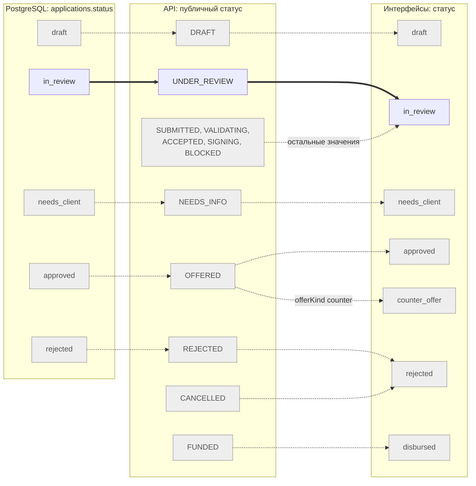
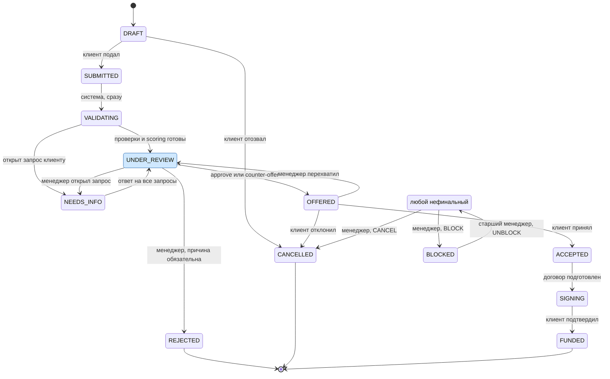

# Статусы заявки

В коде четыре словаря, а не один. Ниже каждый из них, связи между ними и переходы по `plan.md`.

| Словарь              | Где                                                                                      | Значения                                                                                                                                         |
| -------------------- | ---------------------------------------------------------------------------------------- | ------------------------------------------------------------------------------------------------------------------------------------------------ |
| Хранимый статус      | `applications.status`, `applicationWorkflowSchema`, `packages/contracts/src/workflow.ts` | `draft`, `in_review`, `needs_client`, `approved`, `rejected`                                                                                     |
| Публичный статус API | `publicApplicationStatusSchema`, `packages/contracts/src/api.ts`                         | `DRAFT`, `SUBMITTED`, `VALIDATING`, `UNDER_REVIEW`, `NEEDS_INFO`, `OFFERED`, `ACCEPTED`, `SIGNING`, `FUNDED`, `REJECTED`, `CANCELLED`, `BLOCKED` |
| Статус в интерфейсах | `applicationStatusSchema`, `packages/contracts/src/index.ts`                             | `draft`, `in_review`, `needs_client`, `counter_offer`, `approved`, `disbursed`, `rejected`                                                       |
| Этап конвейера       | `applicationStageSchema`, `packages/contracts/src/application.ts`                        | `intake`, `completeness`, `enrichment`, `scoring`, `decision`, `signing`, `disbursement`                                                         |

## Как статусы превращаются друг в друга

`apps/api/.../api-mapper.ts` переводит хранимый статус в публичный, а `api-mapper.ts` в `apps/client` и `apps/backoffice` переводит публичный в статус интерфейса. Сплошной показан единственный путь, который проходит в рантайме: в `applications.status` пишется только `in_review` (`ApplicationsService.create`, `scripts/seed-demo.ts`), и ни скоринг, ни воркер статус не меняют. Серые состояния и пунктирные стрелки есть в маппинге, но не достигаются.

SVG: [02-statuses-mapping.svg](02-statuses-mapping.svg)

Три особенности маппинга. API всегда отдаёт `offerKind: initial`, поэтому `counter_offer` в интерфейсах недостижим. Интерфейсы сворачивают `SUBMITTED`, `VALIDATING`, `ACCEPTED`, `SIGNING` и `BLOCKED` в `in_review`, то есть заблокированная или подписываемая заявка выглядела бы как «на рассмотрении». `OFFERED` без `offerKind` превращается в `approved`.

## Где решение видно без смены статуса

Статус остаётся `in_review`, а решение клиент и сотрудник всё равно видят. Оно выводится из скоринга и сохранённой рекомендации.

| Где                                                                        | Откуда берётся                                                                          | Что получается                                                                                                                                                                               |
| -------------------------------------------------------------------------- | --------------------------------------------------------------------------------------- | -------------------------------------------------------------------------------------------------------------------------------------------------------------------------------------------- |
| Кабинет, `decisionOf` в `apps/client/src/shared/api/cabinet/api-mapper.ts` | `scoring.recommendation` при статусе `UNDER_REVIEW`                                     | `decision.outcome`: `approved`, `counter_offer` или `rejected`; для `request_info` и `manual_review` решения нет. Условия оффера: сумма и срок заявки, `ratePercent: 0`, `monthlyPayment: 0` |
| Кабинет, `checksPassed`                                                    | наличие `scoring`                                                                       | `3`, если скоринг есть, иначе `0`                                                                                                                                                            |
| АРМ, `toArmApplication`                                                    | наличие `scoring`                                                                       | `stage: decision`, `waitingOn: employee`; без `scoring` это `scoring` и `system`                                                                                                             |
| АРМ, `GET /v1/applications/{id}/context`                                   | `applications.decision` (пишет `executeJob`), `application_events`, `autonomy_policies` | рекомендация, правила `decide()`, аудит, снимок автономности                                                                                                                                 |

## Публичные статусы и переходы по plan.md

Таблица допустимых переходов из `plan.md` («Статусы и переходы»). В коде её нет: ни в `apps/api`, ни в интерфейсах нет проверки допустимости перехода. Единственная запись статуса: `WorkflowStore.saveApplication` при создании пишет `in_review`. Цветом выделено единственное состояние, в которое заявка попадает при создании: `UNDER_REVIEW`, минуя `DRAFT`, `SUBMITTED` и `VALIDATING`.

SVG: [02-statuses-public.svg](02-statuses-public.svg)

Встречное предложение остаётся `OFFERED` с признаком `isCounterOffer` (в контракте это `offerKind: counter`). Пауза и срочность управляющие признаки, а не статусы.

## Этапы конвейера

Этап показывает сотруднику, где заявка в конвейере. В коде его нет в хранилище: `apps/backoffice/.../arm/api-mapper.ts` выводит его из наличия `scoring`.

| Условие                | `stage`    | `waitingOn` |
| ---------------------- | ---------- | ----------- |
| у заявки нет `scoring` | `scoring`  | `system`    |
| `scoring` есть         | `decision` | `employee`  |

Остальные этапы (`intake`, `completeness`, `enrichment`, `signing`, `disbursement`) есть в схеме и в интерфейсах, но API их не вычисляет. Восемь внутренних стадий из `plan.md` (`ENRICHING`, `SCORING`, `MANUAL_REVIEW` и другие) в коде не заведены вообще.
