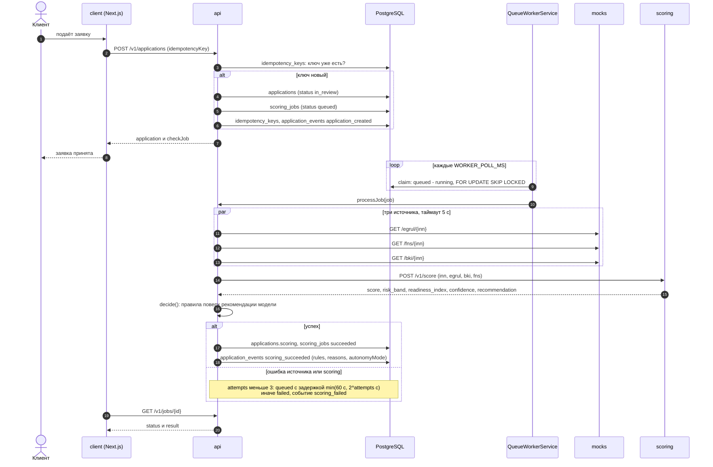
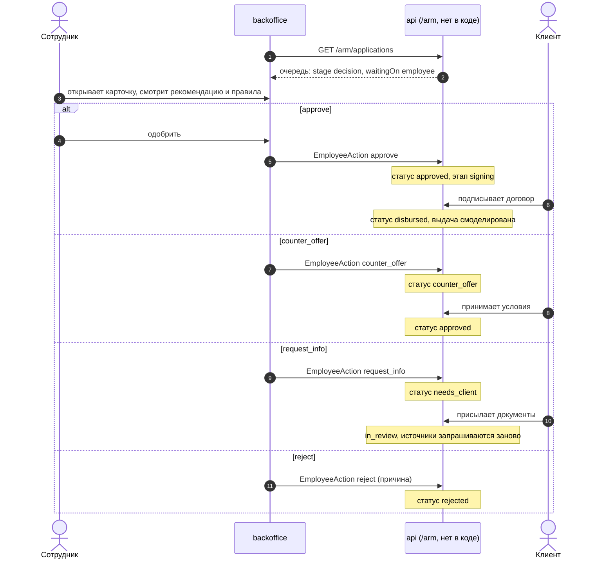

# Подача заявки, скоринг и решение

Последовательность построена по `ApplicationsController`, `ApplicationsService`, `QueueWorkerService`, `WorkflowStore`, `CompaniesService` и `decide()` в `apps/api`.

## Что делает api сейчас

SVG: [03-sequence-api.svg](03-sequence-api.svg)

Рекомендации `decide()`: `reject`, `request_info`, `counter_offer`, `approve` (только при confidence не ниже 0,8 и сумме до 5 000 000), иначе `manual_review`. Режим автономности в текущем коде `shadow` или `assist`. Рекомендация записывается в событие, статус заявки она не меняет.

## Как это продолжается в АРМ

Менеджер видит заявку и принимает решение в интерфейсе `apps/backoffice`. Его HTTP-адаптер ходит на `/api/arm/*`, и этих ручек в `apps/api` нет, поэтому ниже поток по контракту `packages/contracts/src/application.ts`, как его выполняет мок-движок `apps/backoffice/src/shared/api/arm/mock`.

SVG: [03-sequence-backoffice.svg](03-sequence-backoffice.svg)
