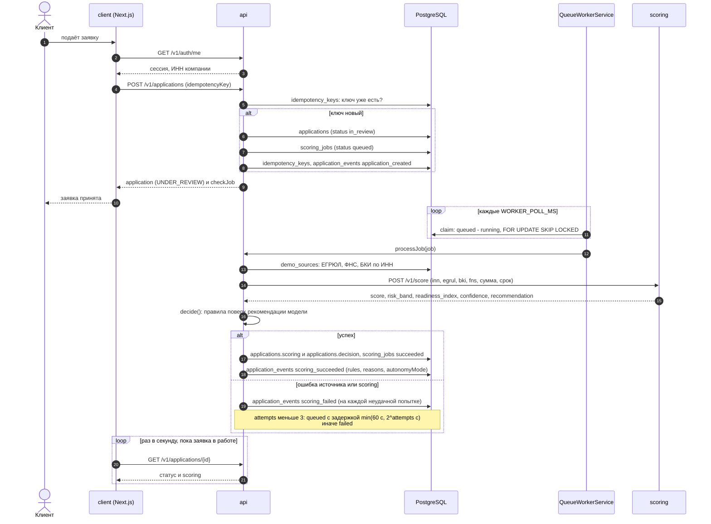
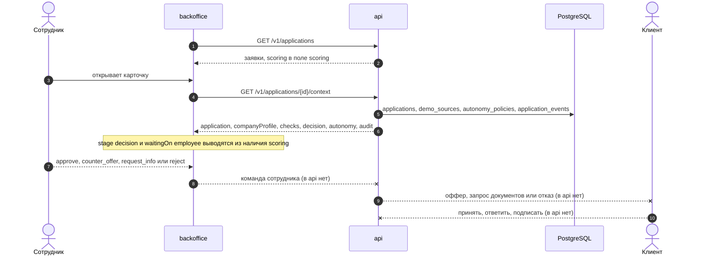

# Подача заявки, скоринг и решение

Последовательность построена по `ApplicationsController`, `ApplicationsService`, `AutonomyStore`, `QueueWorkerService`, `WorkflowStore`, `CompaniesService` и `decide()` в `apps/api`.

## Что делает api сейчас

SVG: [03-sequence-api.svg](03-sequence-api.svg)

Кабинет задачу не опрашивает: `GET /v1/jobs/{id}` вызывает только тот, кто сам запускал проверку. Повторную проверку запускает `POST /v1/applications/{id}/checks` (`startApiCheck`, ответ 202): он создаёт новую задачу `queued` с другим `idempotencyKey`, дальше цикл воркера тот же.

Рекомендации `decide()`: `reject`, `request_info`, `counter_offer`, `approve` (только при confidence не ниже 0,8 и сумме до 5 000 000), иначе `manual_review`. Режим автономности в `decide()` `shadow` или `assist`, он не зависит от политик в `autonomy_policies`. Рекомендация попадает в событие, в `scoring` и в `decision`, статус заявки она не меняет: после скоринга заявка остаётся `in_review`.

## АРМ: что есть и чего нет

АРМ читает очередь через `GET /v1/applications`, а карточку через `GET /v1/applications/{id}/context`: заявка, профиль компании, проверки, решение, снимок автономности и аудит. Команды сотрудника в api не реализованы: `act` и `simulateClient` в `apps/backoffice/src/shared/api/arm/http-api.ts` выбрасывают ошибку «появятся после подключения команд API», а `acceptOffer`, `declineOffer`, `answerRequest` и подписание в кабинете отвечают 501. Стрелки с крестом ниже это путь по `plan.md`, его в коде нет.

SVG: [03-sequence-backoffice.svg](03-sequence-backoffice.svg)
