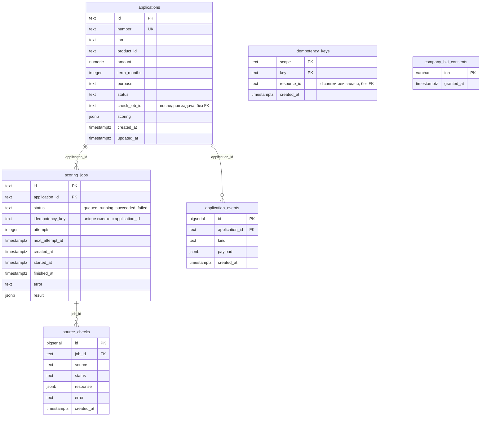

# Модель данных PostgreSQL

Схема взята из `apps/api/src/common/database/migrations/001_workflow.sql`. Таблица `company_bki_consents` в миграцию не входит: её создаёт `CompanyConsentStore` при первом обращении.

SVG: [04-data-model.svg](04-data-model.svg)

## Связи, которых в схеме нет

- `applications.inn` и `company_bki_consents.inn` связаны по значению, внешнего ключа нет. Таблицы компаний нет, профиль собирается из источников на лету.
- `idempotency_keys.resource_id` указывает на задачу или заявку в зависимости от `scope` (`create` или `check:{applicationId}`).
- Индекс очереди: `scoring_jobs_queue_idx (status, next_attempt_at, created_at)`.
- Таблиц сотрудников, документов, продуктов и согласий по заявке нет. Продукты, сотрудники и демо-учётки живут в моках приложений и в `packages/contracts`.
- В `source_checks` код ничего не пишет и не читает: таблица создана, но ответы источников хранятся только в `application_events` и `scoring_jobs.result`.
