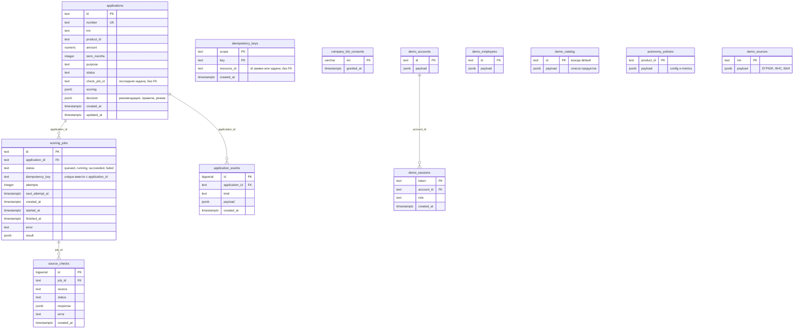

# Модель данных PostgreSQL

Схема взята из `apps/api/src/common/database/migrations/001_workflow.sql`. Таблицы `demo_*` в миграцию не входят: их создаёт `DemoDataStore` при старте api и `pnpm db:seed`. `company_bki_consents` тоже вне миграции: её `CompanyConsentStore` создаёт при первом обращении.

SVG: [04-data-model.svg](04-data-model.svg)

Доменные сущности без привязки к таблицам: [05-entity-model.md](05-entity-model.md).

## Связи, которых в схеме нет

- `applications.inn`, `company_bki_consents.inn` и `demo_sources.inn` связаны по значению, внешнего ключа нет. Таблицы компаний нет, профиль собирается из `demo_sources`.
- `idempotency_keys.resource_id` указывает на задачу или заявку в зависимости от `scope` (`create` или `check:{applicationId}`).
- Индекс очереди: `scoring_jobs_queue_idx (status, next_attempt_at, created_at)`.
- Сотрудники, продукты, демо-учётки и политики автономности хранятся как jsonb-документы в `demo_*` и `autonomy_policies`, а не нормализованными таблицами. Таблиц документов и согласий по заявке нет.
- Копия DDL для `applications`, `scoring_jobs` и `application_events` есть ещё в `WorkflowStore.onModuleInit` и в `apps/api/scripts/seed-demo.ts`, поэтому схема объявлена в трёх местах.
- В `source_checks` код ничего не пишет и не читает: таблица создана, но ответы источников хранятся только в `application_events` и `scoring_jobs.result`.
