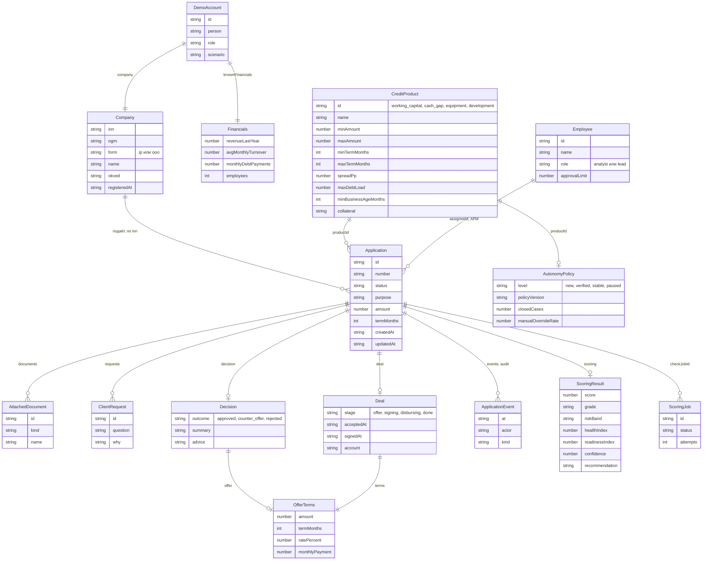

# Модель данных на уровне сущностей

Сущности и связи по `packages/contracts`, без привязки к таблицам. Физическая схема Postgres лежит в [04-data-model.md](04-data-model.md): там заявка это строка `applications`, а продукты, учётки и сотрудники это jsonb-документы.

В контрактах две формы заявки. Кабинет работает с `Application` из `cabinet.ts`, АРМ с `Application` из `application.ts`; обе строятся из `ApiApplication` (`api.ts`), который отдаёт api. Диаграмма показывает общие сущности, различия указаны в таблице под ней.

SVG: [05-entity-model.svg](05-entity-model.svg)

## Чем отличаются формы заявки

| Поле              | Кабинет (`cabinet.ts`)                            | АРМ (`application.ts`)                                        |
| ----------------- | ------------------------------------------------- | ------------------------------------------------------------- |
| Статус            | `applicationStatusSchema`, 7 значений             | тот же словарь                                                |
| Решение           | `Decision` с факторами и советом клиенту          | `creditDecisionSchema`: рекомендация, правила, причина отказа |
| Этап и ход        | нет                                               | `stage`, `waitingOn`, `blocker`, `hold`, `urgent`             |
| Проверки          | `checksPassed` от 0 до 3                          | список `checks` по источникам                                 |
| Диалог с клиентом | `requests`, `deal`                                | `requestedInfo`, `comments`, `handoff`                        |
| Аудит             | `ApplicationEvent` с `actor` client, bank, system | `ApplicationEvent` со сменой статуса и `kind`                 |
| Автономность      | нет                                               | `autonomy` из `GET /v1/applications/{id}/context`             |

`Deal`, `ClientRequest` и `AttachedDocument` описаны в контракте, но api их не хранит: таблиц для них нет, кабинет получает пустые `documents`, `requests`, `events` и `deal: null`.
